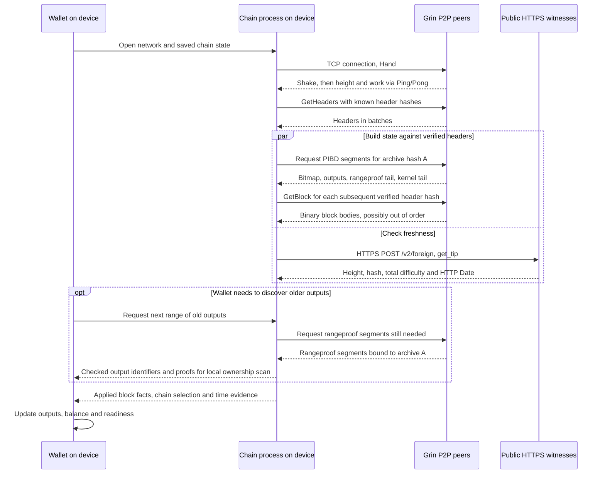

# RFC: How a Grin wallet earns its “Ready to use” status

**Status:** Draft for community and security review · 28 November 2026

**Implementation under review:** GrinSight 0.4.7A, commit `0eafa7d883b541a8ff6cb008122495736684e0f9`

**Decision requested:** Should this wallet use a sampled historical checkpoint as its default starting point, given the evidence it checks afterwards and the meaning it assigns to the green status?

## Motivation and scope

A new Grin wallet should be able to reach a usable balance without operating a full node or depending on a server run by the wallet author. A user who wants to check every historical header should also be able to do so. Version 0.4.7A implements both paths. This RFC concerns wallet policy on the existing Grin network. It proposes no change to block validity, node software or the P2P protocol.

The central review question is about **three different claims**. A checkpoint supplies a starting history. A survey of public nodes helps select a current tip. The wallet must still check its state and catch up to that tip before showing readiness. Each claim can succeed while the next one is still pending.

## 1. Starting history

| How the wallet starts | Evidence available on this device |
| --- | --- |
| New Mainnet profile, default settings | The release supplies a checkpoint at height **4,115,520** and an **8,285,016-byte** GSHP1 history sample. The wallet checks the sample, then validates subsequent headers. The release identifies the initial candidate. |
| User selects verification from genesis | The device validates headers sequentially from the network genesis, including proof of work and the difficulty rules for each era. At a suitable archive height it builds a transferable checkpoint and sample. It verifies the saved pair and commits its local checkpoint and tail before discarding the temporary header journal. |
| User imports a checkpoint | One `.gshp` file carries both the checkpoint and its GSHP1 sample. Its network, checkpoint context and proof are checked before installation. The recipient records imported provenance, even when the sender originally replayed every header. Catch-up, state and freshness checks still run on the recipient. |

Testnet has a separate release point. The 0.4.7A binary bundles a GSHP1 history sample for Mainnet only. [Checkpoint lifecycle and import](ADR-LOCAL-CHECKPOINT.md) · [Genesis verifier](../Source/chain/headers/src/genesis.rs)

### What a GSHP1 verifier learns

The verifier checks **420 deterministic work-weighted draws**. Each answer must cover the requested interval in a tree of work sums. The verifier checks the corresponding run of Grin headers, its proof of work and difficulty context, and inclusion against the header PMMR (prunable Merkle mountain range). For an imported pair the proof must match the exact serialized checkpoint header. A related ancestor alone is insufficient. The outer file begins with `GSHPACK1`, followed by two big-endian 32-bit lengths and the two payloads. The checkpoint record is limited to 64 KiB and the proof to 64 MiB. [Proof checker](../Source/chain/headers/src/proof.rs) · [Sampling](../Source/chain/headers/src/sample.rs) · [Container](../Source/chain/fly-chain/src/bootstrap/package.rs)

**The work-sum tree is supplied by the producer.** Grin headers commit to the header PMMR. They do not commit to this separate tree. The draws become fixed once the producer selects the public inputs. The checked runs leave other historical transitions unexamined. We have no established adversarial failure probability for 420 draws and claim no equivalence to sequential replay. [Security argument and alternatives](BOOTSTRAP-PROOFS.md)

## 2. Network walkthrough: from opening the wallet to the next block

The native application runs a wallet process and a chain process (`fly-chain`). The chain process talks to two sets of participants: Grin P2P peers supply blockchain data, and public HTTPS witnesses report the tip they see. The wallet identifies its own outputs locally. The diagram shows a cold start. The HTTPS survey can overlap archive and block downloads once the headers have caught up.



**1. Reopen local data and find peers.** The chain process starts from the point chosen in §1 and reopens compatible header, archive and block records. On a native device it resolves the configured peer addresses through the OS. With an empty peer list it resolves Grin DNS seeds for the selected network. Explicit P2P peers replace the seed list. It makes outbound TCP connections (default Mainnet port 3414), sends `Hand` and checks the peer's `Shake`, including the network genesis. The normal synchroniser targets three peers and can raise the target to eight for bulk work. Capability flags tell it which connected peers can serve PIBD. A DNS answer locates a peer; successful verification determines whether its data is usable. [Discovery and handshake](../Source/chain/fly-chain/src/node.rs) · [Native connections](../Source/chain/fly-chain/src/net.rs)

**2. Find a common header and follow the chain with the most verified work.** A `GetHeaders` request carries a locator: hashes of headers the client already knows, so a peer can find a common point and send the following `Headers`. The normal synchroniser keeps one such request outstanding and processes batches of up to 512 headers. It checks parent linkage, height, the preceding header PMMR root (`prev_root`), proof of work and the difficulty adjustment for that epoch. Competing branches are compared by verified cumulative work. Ping/Pong heights and work help decide whom to ask next. Locally “caught up” means at least one peer is connected and none advertises more work than the client has checked. The public tip survey is a separate step. Explicit genesis mode checks the historical prefix in order, using its own peer session and a resumable local journal. Both paths use standard header messages. [Header chain](../Source/chain/headers/src/chain.rs) · [Consensus checks](../Source/chain/headers/src/rules.rs) · [Genesis bootstrap](../Source/chain/fly-chain/src/bootstrap.rs)

**3. Choose a state archive.** Grin peers serve a snapshot of prunable chain state at a particular archive header. From its caught-up header height `H`, the client computes the Mainnet archive height as `720 × floor(max(H − 2880, 0) / 720)` and looks up that header in its verified chain. For example, at `H = 4,125,693` this gives `A = 4,122,720`, leaving 2,973 blocks after the archive. These are calculated heights; a usable local archive can change what a given run downloads. All segment requests name the **hash** of A. If the servable archive is below the client's starting point and there is no compatible saved state, it reports the wait until the archive reaches a usable height. If the network advances to a new archive during an incomplete download, the client restarts collection for the new hash. Segments from different archives cannot be combined. [Archive selection and rollover](../Source/chain/fly-chain/src/node.rs)

**4. Fetch and authenticate the state at A using PIBD** (parallel initial block download). Each request carries the archive hash and a segment identifier (height and index). The corresponding binary response carries data and proof material. The stages run in this order:

| Standard Grin request | What the client asks for | What it obtains locally |
| --- | --- | --- |
| `GetOutputBitmapSegment` | All bitmap segments | Positions of outputs still unspent at A |
| `GetOutputSegment` | All output segments for A | The live output identifiers and positions, and output PMMR peaks. The output tree and bitmap must match the header's combined output root. |
| `GetRangeProofSegment` | The last rangeproof segment with its proof | Rangeproof PMMR peaks checked against the archive header |
| `GetKernelSegment` | The last kernel segment with its proof | Kernel PMMR peaks checked against the archive header |

The ordinary initial download needs the **last** rangeproof and kernel segments to carry both trees forward. Searching for pre-archive coins adds separate rangeproof requests in step 6. For output segments, this build first tries height 15 (up to 32,768 leaves). If the initial large requests time out before any output segment is accepted, it falls back to height 11 (2,048 leaves). Both sizes are checked against the same root. Output segments that arrive ahead of their turn can be checked and buffered. The collector commits them in order and exposes a state only after assembly succeeds. [Wire messages](../Source/vendor/grin/p2p/src/msg.rs) · [Download order](../Source/chain/fly-chain/src/state.rs) · [Segment and root checks](../Source/chain/state/src/archive.rs)

**5. Download the bodies from A to the tip.** For each height the client already has a verified header. It sends a binary P2P `GetBlock` naming that header's hash. The look-ahead window covers 16 heights. Peers may return `Block` replies in any order, but the client applies only the next height. If that body is still outstanding after three seconds, a second peer can be asked for it. A newly received body must match the verified header, pass Grin's block checks (including rangeproofs and kernel signatures), spend live inputs, and produce the expected PMMR roots and sizes. The snapshot does not reconstruct the aggregate monetary balance of all blocks before A; checking coinbase maturity also needs sufficient historical context. This is the boundary of the wallet's block checks. [Body pipeline](../Source/chain/fly-chain/src/follow.rs) · [State transitions and limits](../Source/chain/state/src/advance.rs)

**6. Discover wallet outputs locally.** Post-archive bodies already carry their output proofs. During recovery from words, older live outputs need a separate scan. The chain process requests whole rangeproof segments at height 11 for the current servable archive, verifies their inclusion, and passes checked outputs and proofs to the wallet. The wallet uses its keys locally to recognise its outputs, including the legacy proof format where applicable. A returning wallet can skip proof downloads for entire ranges it previously covered when its saved height **and hash** still match the checked branch. The search can prefetch up to 32 segments; a stalled next segment can be requested from a second peer after ten seconds. No peer needs the recovery words, wallet address or a list of outputs owned by the user to perform this scan. [Old-output requests](../Source/chain/fly-chain/src/old.rs) · [Wallet feed](../Source/chain/fly-chain/src/feed.rs) · [Historical recovery formats](ADR-LOCAL-CHECKPOINT.md)

**7. Select a tip and keep following it.** The client asks the public HTTPS sources concurrently for `get_tip` and uses the HTTP `Date` from the same replies for its time check (§3). The wallet can have every requested body and still be waiting for a quorum or usable time. Once the applied state, wallet and selected tip agree, the UI can show readiness (§4). For subsequent blocks the client keeps its P2P connections, processes announcements, fetches missing headers and bodies, and updates its local state. On a reorganisation it rolls back displaced blocks and wallet observations to a common point or requests a new anchor when it cannot continue from there. A green status from a previous branch is insufficient to authorise the new one. [Tip survey](../Source/chain/tips/src/survey.rs) · [Wallet steps and rollback](../Source/chain/fly-chain/src/follow.rs)

### Interruptions, restart and what a remote party sees

- **A peer goes silent.** The bulk scheduler allows up to four outstanding requests per peer per scheduler, spaces requests to that peer by at least 250 ms and expires them after 20 s in the release build. An unanswered piece can be requested elsewhere. A timeout can mean that the peer's archive has moved. A segment that fails authentication against the requested header is discarded. [Scheduling](../Source/chain/fly-chain/src/schedule.rs) · [Peer handling](../Source/chain/fly-chain/src/node.rs)
- **The app closes.** On reopening the chain process checks the saved records against the relevant headers. A valid stored prefix of archive segments can be reused; a damaged suffix is cut off. Compatible saved blocks are reapplied with their roots checked. Out-of-order replies that were still only in memory may be fetched again. This is why a warm launch can need very little traffic even though the wallet still checks the tip. [Archive storage](../Source/chain/state/src/store.rs) · [Block storage](../Source/chain/state/src/blocks.rs)
- **Network visibility.** In the native build, Grin P2P sync and the HTTPS witness survey use direct connections. The DNS resolver sees the names looked up. A P2P peer sees the client's network address, the header locators, archive hashes, segment ranges or block hashes requested from it, and their timing. A witness sees the client's connection and public tip query. Bulk rangeproof requests can reveal a recovery pattern. Tor settings for payment submission and messaging have separate routing rules. Payment-relay monitoring can make transaction-specific requests outside this sync flow. [P2P transport](../Source/chain/fly-chain/src/net.rs) · [HTTPS transport](../Source/chain/tips/src/ask.rs) · [Transaction handling](../Source/chain/fly-chain/src/post.rs)

## 3. Selecting a current tip

In this release the five default Mainnet witnesses are `grincoin.org`, `mainnet.grinffindor.org`, `api.grin.money`, `main.grin.raubritter.org` and `mainnet.grin-coffee.com`. Two share a recorded ASN. These names identify the HTTPS survey participants; the bulk downloads use the separately discovered P2P peers. The survey posts the following JSON-RPC body to each witness's `/v2/foreign` endpoint. It compares the returned height, block hash and total difficulty with its locally verified tip. A separate checkpoint-checking routine can query `get_header` at a chosen height. The wallet does not poll an HTTP endpoint for every block. [Request encoder](../Source/chain/tips/src/http.rs) · [Checkpoint polling](../Source/chain/tips/src/point.rs)

```json
{"jsonrpc":"2.0","method":"get_tip","params":[],"id":1}
```

The default Mainnet survey contains five public Foreign API sources. A round fixes its tip, source list and deadline. At least half the list, rounded up, must confirm or report a known ancestor in time. Two sources must confirm the exact height, hash and total difficulty and have different recorded operator groups **and** known, different ASNs. The eligible Mainnet list must represent at least three groups. A timely claim that the source is ahead prevents that round from confirming. A previous quorum may cover a locally checked descendant while the confirmed block remains on the branch and no warning calls for a new survey. [Round verdict](../Source/chain/tips/src/generation.rs) · [Source independence](../Source/chain/tips/src/source.rs)

Release 0.4.7A derives a time interval from the HTTPS responses of independent sources. Checks include a round trip of at most 30 seconds, agreement between intervals, compatibility with the OS clock and the retained lower bound. A valid interval can be reused for up to six hours, subject to the clock checks. A single missed poll can therefore leave earlier evidence valid. When valid time or selection is lost, readiness must be withdrawn. These checks assume accurate operator metadata and sufficiently independent clocks and network paths. [Time policy](../Source/chain/tips/src/time.rs) · [Selection tests](../Source/chain/fly-chain/tests/accept.rs)

## 4. Showing a usable wallet

The wallet checks the archive state and applies subsequent blocks. The UI reads the balance, wallet height, selected height and confirmed time from one wallet status response. A missing balance, mismatch of heights or an active search for old outputs keeps the wallet from showing readiness. The badge above the balance, its details and the persistent indicator in **Connection and synchronisation** share the wallet verdict. Green **Ready to use** describes the wallet on its selected chain. Inclusion and confirmation of an individual payment require their own evidence. A transport receipt cannot supply it. [UI decision](../Source/ui/app/src/live.rs) · [Loss and recovery tests](../Source/ui/app/src/live/freshness_tests.rs)

## Evidence reviewers can reproduce

| Final Windows portable on public Mainnet | First process launch to ready | Relaunch to ready | Result above balance and in Details |
| --- | ---: | ---: | --- |
| Empty profile, bundled checkpoint, no import | 185 s | 18.6 s | Both showed VERIFIED at 4,125,693 on both launches |
| Empty profile, imported checkpoint at 4,122,000 | 162.9 s | 28.7 s | Both showed VERIFIED at 4,125,685, then at 4,125,686 |

These timed runs used empty wallets. They measure startup and selection, not recovery of historical funds or payment settlement. The no-quorum, expired-time and missing-balance cases used controlled inputs. The Windows candidate SHA-256 is `a914e83d0f1e59324bcaf1ed44acc55d50889b7c01bea74fa5951d01d3026eac`. [Acceptance record](BOOTSTRAP-0.4.7A-ACCEPT.md) · [Release security review and open dependency findings](RELEASE-0.4.7A-SECURITY.md)

For offline review, put this RFC in the `Documents` directory of the unpacked 0.4.7A source archive. Its relative links point into that tree. With the locked dependencies available, run these commands from `Source/chain/fly-chain`. The first suite exercises malformed packages and backward compatibility. The second exercises selection, time expiry and changes of branch.

```sh
cargo test --release --locked --features history-proof --test checkpoint_package
cargo test --locked --features test-net --test accept
```

For the network walkthrough, one integration case follows genesis through PIBD and a restart against an ordinary local test peer. The other suites cover moved archives, resuming an incomplete download, out-of-order bodies and discovery of old outputs. [Archive integration tests](../Source/chain/fly-chain/tests/state.rs) · [Block pipeline tests](../Source/chain/fly-chain/tests/blocks.rs) · [Old-output tests](../Source/chain/fly-chain/tests/old.rs)

```sh
cargo test --locked --features test-net --test blocks autonomous_genesis_pibd_and_restart_on_an_ordinary_node -- --exact
```

For a user-visible check, open the portable with an empty Mainnet profile, leave the checkpoint settings at their defaults and compare the selected height above the balance with Details. Close and reopen the same profile and compare again. The reported height may advance between launches. [Windows acceptance harness](../Source/tools-audit/check_public_wallet_window.py)

## Questions for reviewers

1. **Default trust.** Is sampled history an acceptable default if Details identifies its origin? Should the main screen distinguish “sampled history” from “verified locally from genesis” even after both wallets reach the same tip?
2. **Proof binding.** Which claims about cumulative work follow from the checked PMMR paths and weighted intervals when the producer chooses the work-sum root? What additional commitment or assumption would be needed to state a quantitative bound?
3. **Freshness.** Are the operator/ASN rule, HTTPS time and reuse of a quorum on an ancestor strong enough for the green status? Which loss of evidence should require a fresh round before another block can be shown as ready?
4. **Recovery and presentation.** Can import, interrupted compaction, reorganisation or reopening leave the displayed balance attached to a different selection or provenance? Which transition is missing from the acceptance suites?

For each finding, please identify the affected claim, the code or test behind it, and the status the wallet should show. A counterexample, a proposed additional test or a narrower user-facing claim would each be useful. Independent cryptographic review remains open.
