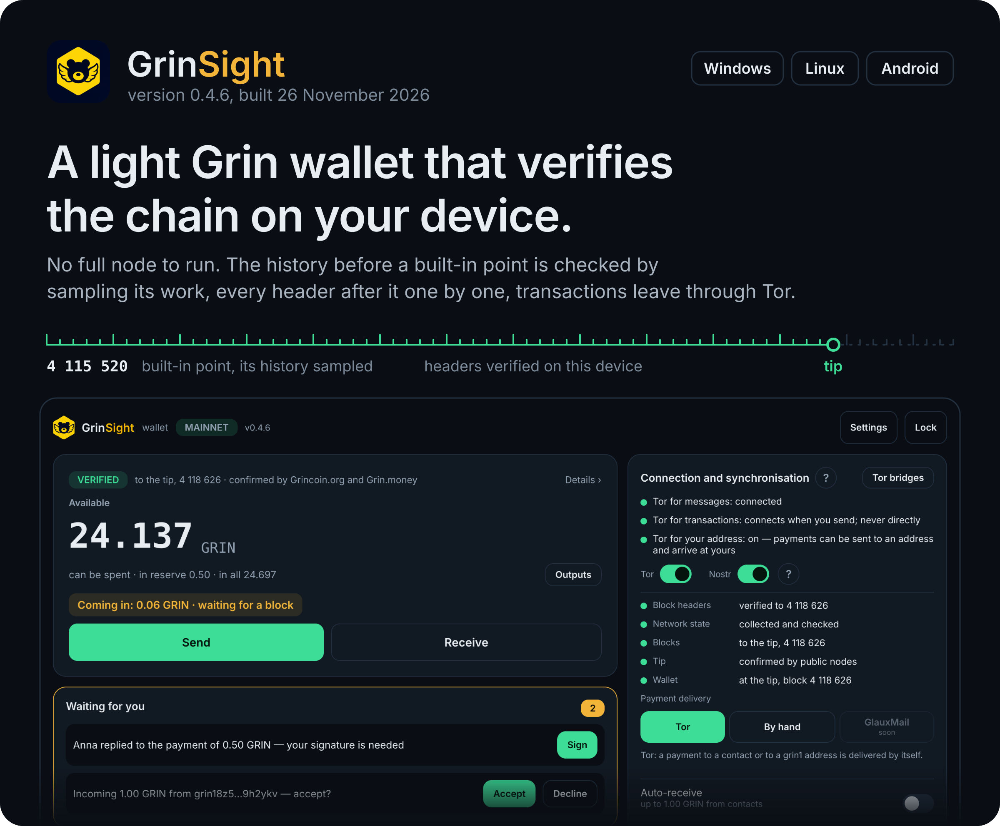
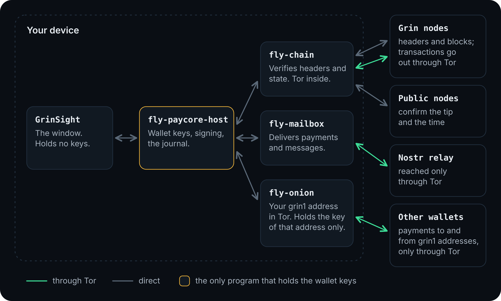
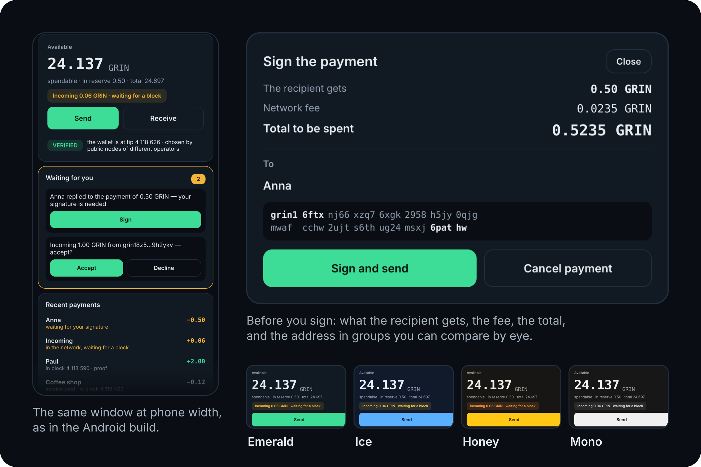

<p align="center"><b>English</b> · <a href="README.ru.md">Русский</a> · <a href="https://danilagrinrus.github.io/GrinSight/en/">Website</a></p>

<p align="center">
  
</p>

GrinSight is a research light wallet for [Grin](https://grin.mw). It needs no full node of its own: it checks the header chain from a built-in point to the tip, confirms the tip with public nodes, collects and verifies the state its outputs depend on, and sends transactions through its own Tor. Nothing is signed and there has been no independent audit by a human; what was and was not checked is listed below.

## Download

Version **0.4.3** — [all files and SHA-256 sums](https://github.com/DanilaGrinRus/GrinSight/releases/tag/v0.4.3).

| Platform | File |
|---|---|
| **Windows 10/11 x64** — installer, no administrator rights | [GrinSight-0.4.3-windows-x64-setup.exe](https://github.com/DanilaGrinRus/GrinSight/releases/download/v0.4.3/GrinSight-0.4.3-windows-x64-setup.exe) |
| **Windows x64** — portable, one file | [GrinSight-0.4.3-windows-x64-portable.exe](https://github.com/DanilaGrinRus/GrinSight/releases/download/v0.4.3/GrinSight-0.4.3-windows-x64-portable.exe) |
| **Linux** — Debian 10+ / Ubuntu 20.04+ | [GrinSight-0.4.3-linux-amd64.deb](https://github.com/DanilaGrinRus/GrinSight/releases/download/v0.4.3/GrinSight-0.4.3-linux-amd64.deb) |
| **Linux** — Fedora / RHEL 8+ | [GrinSight-0.4.3-linux-x86_64.rpm](https://github.com/DanilaGrinRus/GrinSight/releases/download/v0.4.3/GrinSight-0.4.3-linux-x86_64.rpm) |
| **Linux** — any with glibc 2.28+ | [GrinSight-0.4.3-linux-x86_64.tar.gz](https://github.com/DanilaGrinRus/GrinSight/releases/download/v0.4.3/GrinSight-0.4.3-linux-x86_64.tar.gz) |
| **Android 8+** (arm64) — checked on an emulator only | [GrinSight-0.4.3-android-arm64.apk](https://github.com/DanilaGrinRus/GrinSight/releases/download/v0.4.3/GrinSight-0.4.3-android-arm64.apk) |
| **macOS 11+** — Apple silicon and Intel; no Tor bridges, not started on a real Mac | [GrinSight-0.4.3-macos-universal.dmg](https://github.com/DanilaGrinRus/GrinSight/releases/download/v0.4.3/GrinSight-0.4.3-macos-universal.dmg) |

Check a file before running it — the hash must match its line in `SHA256SUMS.txt`:

```powershell
Get-FileHash .\GrinSight-0.4.3-windows-x64-setup.exe -Algorithm SHA256
```

On Windows and Linux 0.4.3 installs as **GrinSight Light**, next to GrinSight 0.4.2 if you have it; it does not pick up a 0.4.2 wallet — restore it from its words.

## How long it takes

Measured on mainnet, on Windows, on a home connection.

| What you do | Time |
|---|---|
| A new wallet until **Verified** | about 3.5 minutes |
| Restore from 24 words until the old outputs are found | about 7 minutes |
| A later start until **Verified** | about 3 minutes |
| A payment, from signing to a block | 30–80 seconds |

## Quick guide

1. **Check the file** against `SHA256SUMS.txt`, install it or put the portable file in a folder of its own, start GrinSight.
2. **Create a wallet.** Any password is accepted; twelve characters or more are advised. Write the 24 words on paper: they are shown once.
3. **Wait for Verified** under the balance. *Synchronisation* shows the whole path with numbers; *Problems* says what is wrong and what to try.
4. **Receive:** *Receive* → copy your address for the sender: a payment sent to it over Tor arrives by itself and waits for your yes (about 40 seconds). Or paste the Slatepack text you were sent and return the reply.
5. **Send:** *Send* → the amount → the recipient's `grin1…` address → the payment goes over Tor and the reply comes back under *Waiting for you* → check the amount, the fee and the address → *Sign and send*. By hand: *Make the Slatepack text* → paste the reply. To a saved contact the payment travels over Tor by itself.
6. **Restore:** *Restore* on the first screen → the 24 words → a new password.

More: [How it works and how to use it](Documents/HOW_IT_WORKS_EN.md).

## How it checks

1. **Headers.** Every header from the built-in point (mainnet height 4,115,520) to the tip is checked by the node's own rules: proof of work, difficulty, links. A heavier branch replaces the tip only when it carries more total work.
2. **Coin state.** The unspent outputs are collected from PIBD segments at the nodes' archive point and matched to the roots in a verified header.
3. **Every block** from the archive point to the tip is checked against its header before the wallet sees it.
4. **Tip and time** are confirmed by public nodes of different operators, asked over HTTPS. Your outputs are found with your own keys; no server is asked "what's my balance?".

<p align="center">
  
</p>

## What you get

- **Keys stay on your device,** in a process of their own; the window holds none. The journal is encrypted with your password.
- **Payments:** straight to a `grin1…` address over Tor and receiving at your own address; by Slatepack text; to a contact over Nostr through Tor; pay an invoice; cancel a prepared payment; confirmation by kernel in a block of the verified chain.
- **Its own Tor** for sending transactions; a direct connection only if you allow it. **obfs4 and Snowflake bridges** where Tor is blocked: the built-in ones of Tor Browser or your own; with bridges chosen the wallet reaches Tor through them only.
- **A QR code** of the address and of the Slatepack text; **Slatepack as a file** in the wallet's own folder.
- **A rollback is noticed:** a wallet file replaced with an older copy is refused for signing what it can no longer account for.
- **Messages between contacts,** four themes, English and Russian.

<p align="center">
  
</p>

## What was checked, and what was not

- 599 tests on Windows in 23 sections, none failed; the window is driven against the real wallet process in 62 steps on Windows, Debian 10 and macOS.
- Five review rounds by an AI reviewer: 50 findings, all fixed. **No audit by a human.**
- On mainnet the author restored a wallet from its words and exchanged payments with Grim 0.3.7 over Tor in both directions (Windows, the build before the published one). **Other wallets, paying an invoice and cancelling were not run live with this build**; they are covered by tests.
- **Android was run on an emulator only. The macOS image was built and its window scenario run on GitHub's machine; it was not started on a real Mac and has no Tor bridges. Nothing is signed.**
- Not in this version, present in 0.4.2: scanning QR codes, GlauxNet, "Check myself" from the first block, "Try the future".

Details: [Release notes](Documents/RELEASE_NOTES_EN.md) · [Mathematics and trust boundaries](Documents/MATHEMATICS_EN.md).

## Documentation

| | |
|---|---|
| How it works and how to use it | [HOW_IT_WORKS_EN](Documents/HOW_IT_WORKS_EN.md) |
| Mathematics and trust boundaries | [MATHEMATICS_EN](Documents/MATHEMATICS_EN.md) |
| Release notes | [RELEASE_NOTES_EN](Documents/RELEASE_NOTES_EN.md) |
| Source code: payment core, chain layer, delivery, window (Rust, Slint), build scripts | [Source](Source) |

## License

Free to use, change and share **with attribution to the author (DanilaBear)**: GrinSight's own code — [MIT](LICENSE); documentation and diagrams — [CC BY 4.0](LICENSE-DOCS.md); third-party components keep their own licenses — [NOTICE](NOTICE.md). The packages include the Slint toolkit under GPLv3, so **the packages as a whole are distributed under the GPL, version 3**; the source of each release is in its `source.zip`.
