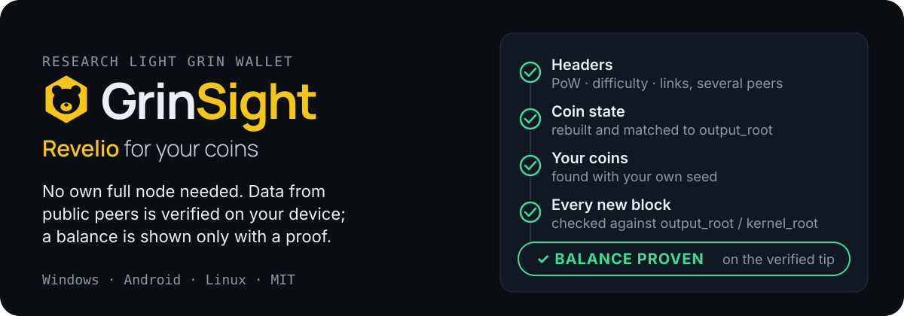
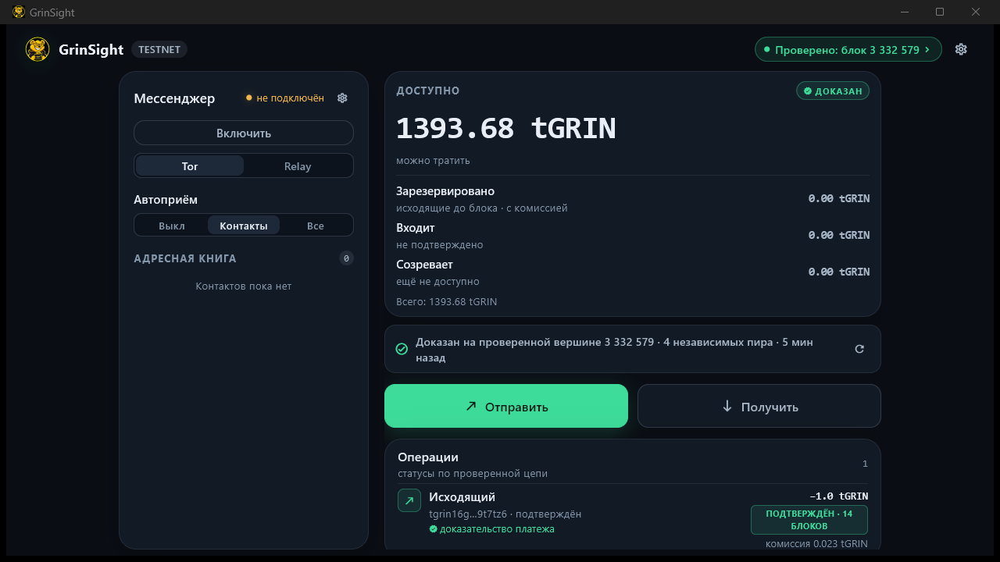
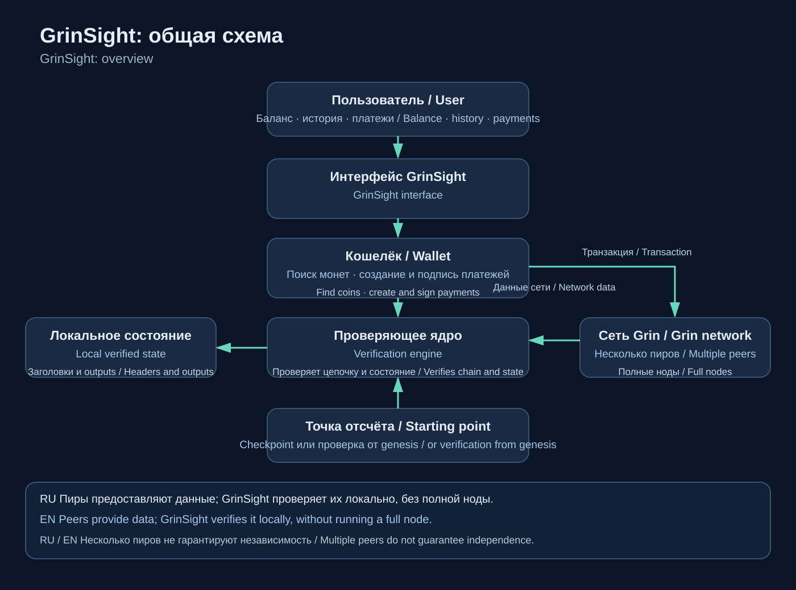
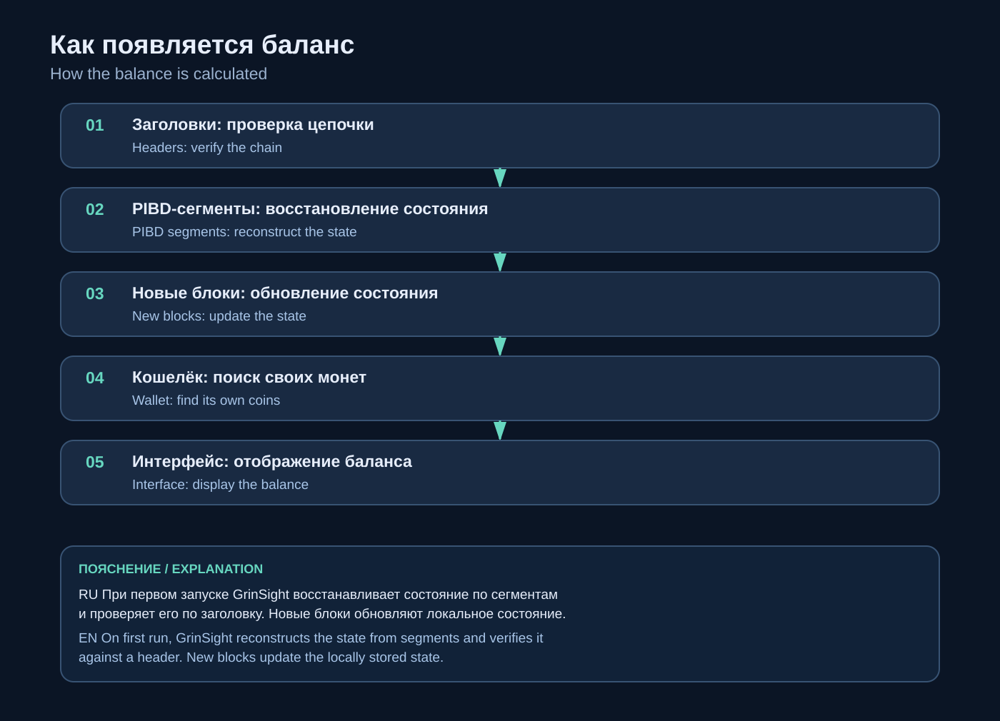
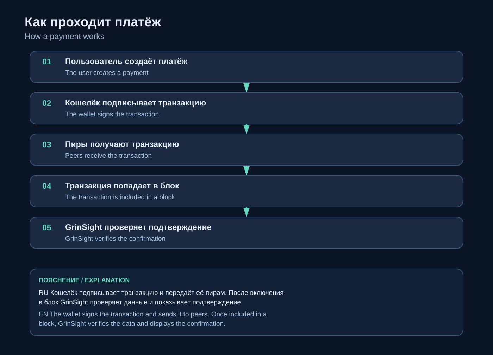

<p align="center"><b>English</b> · <a href="README.ru.md">Русский</a> · <a href="https://danilagrinrus.github.io/GrinSight/en/">Website</a></p>

<p align="center">
  
</p>

GrinSight is a research light Grin wallet. No own full node is required: it downloads data from several public Grin peers, verifies it on your device and shows a balance only after proving it against the chain. The result depends on the checkpoint, the network environment and the correctness of the implementation; there has been no independent security audit yet.

<p align="center">
  
</p>
<p align="center"><sub>Windows, testnet: the balance is marked “proven” on verified block 3,332,579, from 4 peers.</sub></p>

## Download

Version **0.4.0** — [all files and SHA-256 sums](https://github.com/DanilaGrinRus/GrinSight/releases/tag/v0.4.0). Every package has the signed mainnet checkpoint inside.

| Platform | File |
|---|---|
| **Windows 10/11 x64** — installer, no administrator rights needed | [GrinSight-0.4.0-windows-x64-setup.exe](https://github.com/DanilaGrinRus/GrinSight/releases/download/v0.4.0/GrinSight-0.4.0-windows-x64-setup.exe) |
| **Linux** — Debian / Ubuntu amd64, Tor included | [GrinSight-0.4.0-linux-amd64.deb](https://github.com/DanilaGrinRus/GrinSight/releases/download/v0.4.0/GrinSight-0.4.0-linux-amd64.deb) |
| **Android 7+** (arm64) — preview build | [GrinSight-0.4.0-android-arm64.apk](https://github.com/DanilaGrinRus/GrinSight/releases/download/v0.4.0/GrinSight-0.4.0-android-arm64.apk) |

Check a file before running it — the hash must match its line in `SHA256SUMS.txt`:

```powershell
Get-FileHash .\GrinSight-0.4.0-windows-x64-setup.exe -Algorithm SHA256
```

**First launch takes 10–20 minutes** (about 670 MB) while the wallet builds its verified state. After that, every launch is a short update — seconds.

## Checked on the live networks

Release 0.2.0:

- **Mainnet:** five transactions sent from the wallet were confirmed in blocks 4,100,766 – 4,100,860.
- **Floonet:** a 1 tGRIN payment between two wallets through the app (S1 → S2 → finalize → broadcast), confirmed at depth 14, with a payment proof.
- Acceptance tests: core, verification, payment failure points, reorg, fuzzing, dependency advisories, an end-to-end test of the wallet service.

## How it checks

1. **Headers** come from several public peers. Each one is checked: proof of work, difficulty, links. The heaviest chain is accepted only if peers from different networks agree on it.
2. **Coin state** — the set of unspent outputs is rebuilt and matched to the commitment in the block header (`output_root`). A peer can't slip in a fake coin or hide a real one.
3. **Your coins** are found with your own seed. The wallet never asks a server “what's my balance?”.
4. **Every new block** is checked against its header (`output_root` / `kernel_root`). If a check fails, the wallet shows no balance rather than a wrong one.

<details>
<summary>Diagrams: overview, balance, payment</summary>






</details>

## What you get

- **Keys stay on your device.** The phrase (12, 18 or 24 words, compatible with grin-wallet and Grin++) is encrypted with your password (scrypt + ChaCha20-Poly1305).
- **Payments:** send, receive, invoices (slatepack), QR, automatic broadcast, confirmation by kernel in a block of the verified chain, payment proof.
- **Tor payments** compatible with grin-wallet and Grin++.
- **GlauxNet** (Windows): your own encrypted mailbox behind your Tor onion — payments and invoices reach you without a third-party server.
- **Balance split:** available / reserved / incoming / immature.

## Trust boundaries

- Mainnet starts from a **checkpoint** (height 4,098,960) signed with a key built into the wallet. You don't have to trust it: **“Check myself”** downloads every header from the first block, checks each one and confirms the shipped checkpoint is on the same chain.
- Peers from different /16 networks do not prove that the peers are independent. Requiring them to agree makes collusion harder, but does not rule it out.
- No independent security audit yet.
- The Android build is a preview. GlauxNet runs on Windows only. “Try the future” is an experiment: the balance is still checked the usual way.

Details: [Mathematics and trust boundaries](Documents/MATHEMATICS_EN.md).

## Documentation

| | |
|---|---|
| How it works and how to use it | [HOW_IT_WORKS_EN](Documents/HOW_IT_WORKS_EN.md) |
| Mathematics and trust boundaries | [MATHEMATICS_EN](Documents/MATHEMATICS_EN.md) |
| Release notes | [RELEASE_NOTES_EN](Documents/RELEASE_NOTES_EN.md) |
| Source code: core (Rust), Tor / GlauxNet, C API, Flutter app, build scripts | [Source](Source) |

## License

Free to use, change and share **with attribution to the author (DanilaBear)**: code — [MIT](LICENSE); documentation and diagrams — [CC BY 4.0](LICENSE-DOCS.md); third-party components keep their own licenses — [NOTICE](NOTICE.md).
