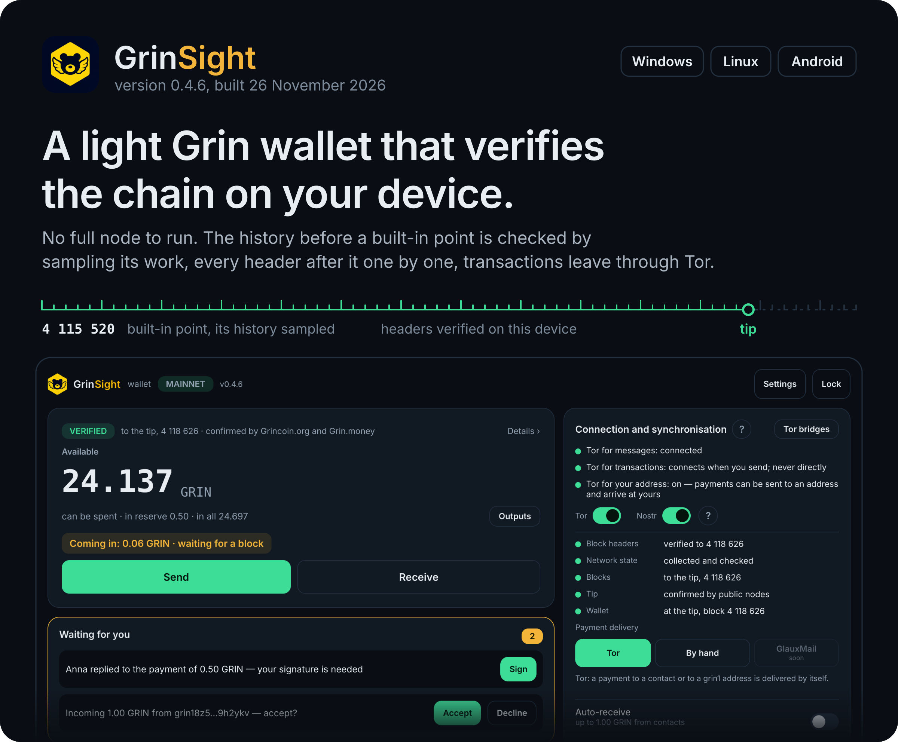

<a href="README.md">English</a> · <b>Русский</b> · <a href="https://danilagrinrus.github.io/GrinSight/">Сайт</a>

# GrinSight 0.4.7A

GrinSight проверяет заголовки Grin, неизрасходованные выходы и выбранную вершину на вашем устройстве. Кошелёк работает со стандартными публичными нодами. После проверки от genesis свою точку можно сохранить вместе с доказательством.

  

## Загрузка

[Файлы этой версии](https://github.com/DanilaGrinRus/GrinSight/releases/tag/v0.4.7A) · [SHA256SUMS.txt](https://github.com/DanilaGrinRus/GrinSight/releases/download/v0.4.7A/SHA256SUMS.txt) · [Исходники](https://github.com/DanilaGrinRus/GrinSight/releases/download/v0.4.7A/GrinSight-0.4.7A-source.zip)

## Руководство кошелька

- **Запуск**. Выберите язык, затем создайте или восстановите кошелёк. Windows portable хранит профиль в папке data рядом с EXE.
- **Восстановление**. Введите слова в исходном порядке. Пример ввода открывается кнопкой «?» у поля. Задайте пароль для этого устройства.
- **Проверка**. Над балансом и в подробностях показан статус одной и той же проверки. Жёлтый означает, что проверка продолжается. Зелёное «ПРОВЕРЕНО» означает, что кошелёк готов.
- **Получение**. Передайте адрес для получения или обменяйтесь Slatepack вручную. Автоприём от контактов можно включить в настройках.
- **Отправка**. Перед подписью сверьте сумму, комиссию и получателя. Статус каждой операции есть в истории.
- **Перенос точки**. В настройках сохраните точку и доказательство в один файл. Второй кошелёк проверит его перед использованием. Слова восстановления храните отдельно.

## Проверки

Автор проверил в Mainnet перевод на другой кошелёк, обратный перевод и перевод самому себе. При проверке обновления Windows сравнили адрес, три операции, доступные и зарезервированные выходы и сохранённую подписанную транзакцию после двух открытий.

Независимый криптографический аудит человеком остаётся открытым. У импортированной точки и собственной проверки от genesis разные основания доверия. При недоступности кворума или времени причина указана в подробностях. Сверяйте загруженные файлы по контрольным суммам выпуска.

[Изменения](Documents/RELEASE_NOTES_RU.md) · [Приёмка](Documents/BOOTSTRAP-0.4.7A-ACCEPT.md) · [Проверка безопасности](Documents/RELEASE-0.4.7A-SECURITY.md)

## Лицензия

Можно использовать, менять и распространять **с указанием автора (DanilaBear)**: собственный код GrinSight — [MIT](LICENSE); документация и схемы — [CC BY 4.0](LICENSE-DOCS.md); сторонние компоненты — под своими лицензиями, см. [NOTICE](NOTICE.md). В пакеты входит библиотека Slint под GPLv3, поэтому **пакеты целиком распространяются под GPL версии 3**; исходники каждого выпуска — в его `source.zip`.
