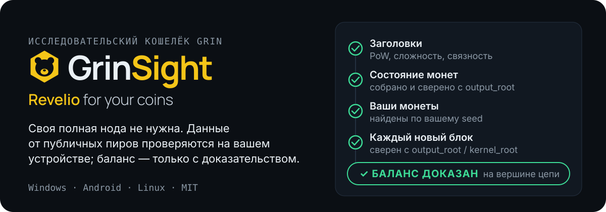
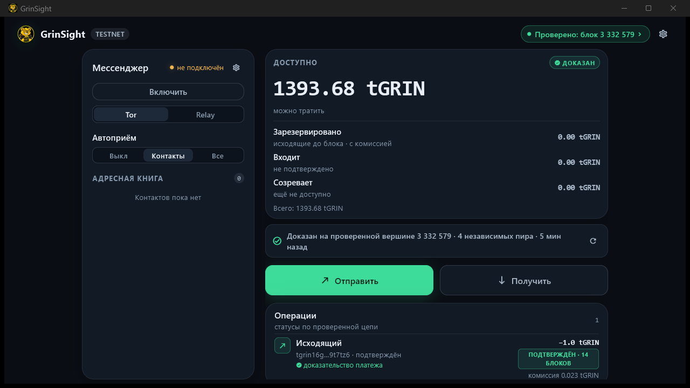
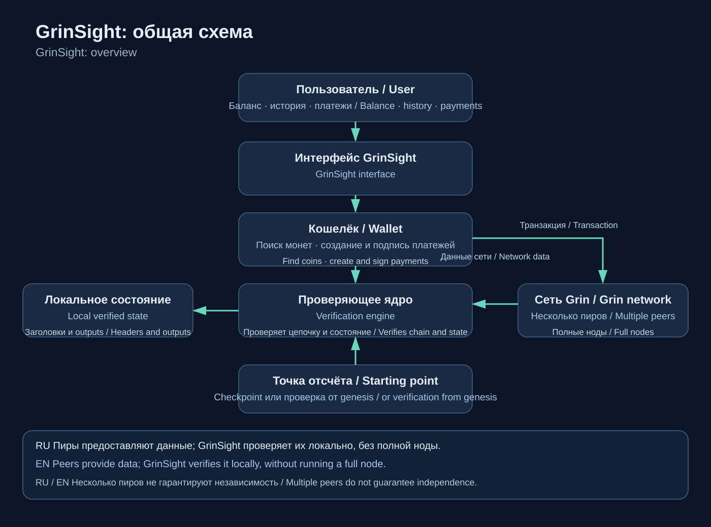
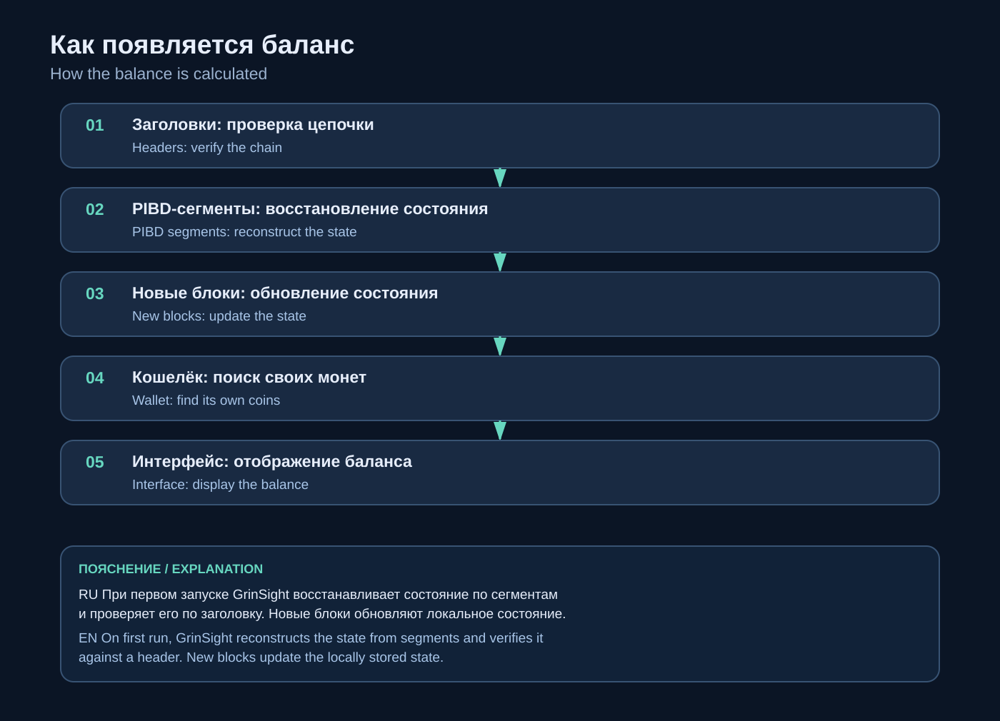
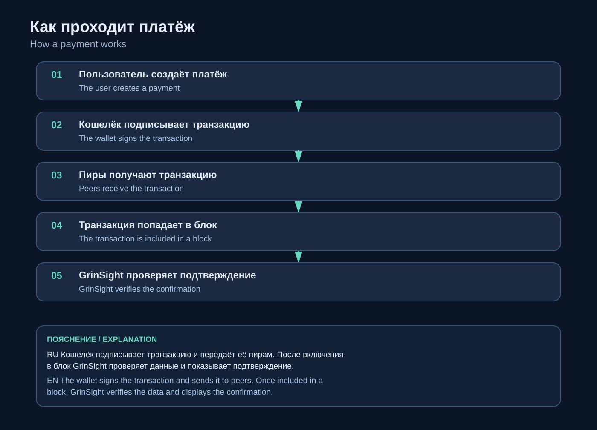

<p align="center"><a href="README.md">English</a> · <b>Русский</b> · <a href="https://danilagrinrus.github.io/GrinSight/">Сайт</a></p>

<p align="center">
  
</p>

GrinSight — исследовательский лёгкий кошелёк Grin. Своя полная нода не нужна: он скачивает данные у нескольких публичных пиров Grin, проверяет их на вашем устройстве и показывает баланс только после доказательства по цепочке. Результат зависит от контрольной точки, сетевого окружения и корректности реализации; независимого аудита безопасности пока не было.

<p align="center">
  
</p>
<p align="center"><sub>Windows, тестовая сеть: баланс помечен «доказан» на проверенном блоке 3 332 579, данные от 4 пиров.</sub></p>

## Скачать

Версия **0.4.0** — [все файлы и суммы SHA-256](https://github.com/DanilaGrinRus/GrinSight/releases/tag/v0.4.0). В каждом пакете — подписанная контрольная точка mainnet.

| Платформа | Файл |
|---|---|
| **Windows 10/11 x64** — установщик, права администратора не нужны | [GrinSight-0.4.0-windows-x64-setup.exe](https://github.com/DanilaGrinRus/GrinSight/releases/download/v0.4.0/GrinSight-0.4.0-windows-x64-setup.exe) |
| **Linux** — Debian / Ubuntu amd64, Tor внутри | [GrinSight-0.4.0-linux-amd64.deb](https://github.com/DanilaGrinRus/GrinSight/releases/download/v0.4.0/GrinSight-0.4.0-linux-amd64.deb) |
| **Android 7+** (arm64) — предварительная сборка | [GrinSight-0.4.0-android-arm64.apk](https://github.com/DanilaGrinRus/GrinSight/releases/download/v0.4.0/GrinSight-0.4.0-android-arm64.apk) |

Проверьте файл перед запуском — хэш должен совпасть со строкой этого файла в `SHA256SUMS.txt`:

```powershell
Get-FileHash .\GrinSight-0.4.0-windows-x64-setup.exe -Algorithm SHA256
```

**Первый запуск — 10–20 минут** (около 670 МБ): кошелёк собирает проверенное состояние. Дальше каждый запуск — короткое обновление за секунды.

## Проверено в живых сетях

Релиз 0.2.0:

- **Mainnet:** пять транзакций, отправленных из кошелька, подтверждены в блоках 4 100 766 – 4 100 860.
- **Floonet:** платёж 1 tGRIN между двумя кошельками через приложение (S1 → S2 → финализация → отправка в сеть), подтверждён на глубине 14, с доказательством платежа.
- Приёмочные тесты: ядро, проверка, точки отказа платежа, реорганизация, фаззинг, уязвимости зависимостей, сквозной тест сервиса кошелька.

## Как он проверяет

1. **Заголовки** — от нескольких публичных пиров. Каждый проверяется: доказательство работы, сложность, связность. Самая тяжёлая цепь принимается, только если на ней сходятся пиры из разных сетей.
2. **Состояние монет** — набор непотраченных выходов собирается заново и сверяется с обязательством в заголовке блока (`output_root`). Пир не может подсунуть фальшивую монету или спрятать настоящую.
3. **Ваши монеты** находятся по вашему seed. Кошелёк никогда не спрашивает у сервера «какой у меня баланс?».
4. **Каждый новый блок** сверяется со своим заголовком (`output_root` / `kernel_root`). Если проверка не прошла, кошелёк не покажет баланс вовсе — но никогда не покажет неверный.

<details>
<summary>Схемы: общая, баланс, платёж</summary>






</details>

## Что вы получаете

- **Ключи остаются на устройстве.** Фраза (12, 18 или 24 слова, совместима с grin-wallet и Grin++) зашифрована вашим паролем (scrypt + ChaCha20-Poly1305).
- **Платежи:** отправка, приём, счета (slatepack), QR, автоматическая отправка в сеть, подтверждение по ядру в блоке проверенной цепи, доказательство платежа.
- **Платежи через Tor**, совместимые с grin-wallet и Grin++.
- **GlauxNet** (Windows): свой зашифрованный почтовый ящик за вашим Tor onion — платежи и счета доходят без стороннего сервера.
- **Баланс по частям:** доступно / зарезервировано / входит / созревает.

## Границы доверия

- Mainnet стартует с **контрольной точки** (высота 4,098,960), подписанной ключом, встроенным в кошелёк. Верить ей не обязательно: **«Проверить сам»** скачивает все заголовки с первого блока, проверяет каждый и убеждается, что поставочная точка на той же цепи.
- Разные сети /16 не доказывают, что пиры независимы. Требование их согласия усложняет сговор, но не исключает его.
- Независимого аудита безопасности пока не было.
- Сборка для Android — предварительная. GlauxNet работает только на Windows. «Попробовать будущее» — эксперимент: баланс по-прежнему проверяется обычным способом.

Подробно: [Математика и границы доверия](Documents/MATHEMATICS_RU.md).

## Документация

| | |
|---|---|
| Как работает и как пользоваться | [HOW_IT_WORKS_RU](Documents/HOW_IT_WORKS_RU.md) |
| Математика и границы доверия | [MATHEMATICS_RU](Documents/MATHEMATICS_RU.md) |
| Что нового в версии | [RELEASE_NOTES_RU](Documents/RELEASE_NOTES_RU.md) |
| Исходники: ядро (Rust), Tor / GlauxNet, C API, приложение на Flutter, скрипты сборки | [Source](Source) |

## Лицензия

Свободно использовать, изменять и распространять **с указанием автора (DanilaBear)**: код — [MIT](LICENSE); документация и схемы — [CC BY 4.0](LICENSE-DOCS.md); сторонние компоненты — по своим лицензиям, см. [NOTICE](NOTICE.md).
